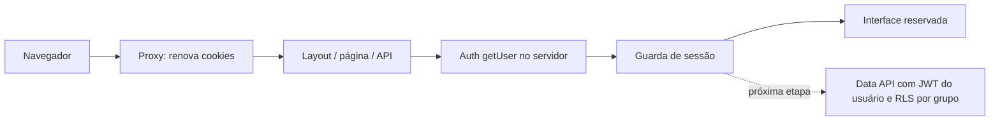

# Arquitetura

## Estado da entrega

Fundação local Next.js App Router, React, TypeScript strict, Tailwind CSS e componentes shadcn/ui mantidos no repositório. Supabase será a infraestrutura de Auth, PostgreSQL e Storage; Vercel é o destino futuro. Não há dependência de serviços provisionados para abrir a interface ou compilar.

A Etapa 002 implementa o schema em cinco migrations novas, com RLS, triggers de integridade e RPCs administrativas. Elas foram aplicadas ao desenvolvimento hpbvtqvbtyioqjyelrpb em 20/10/2026, via MCP oficial. Tipos oficiais remotos estão em src/types/database.types.ts e são usados pelos clientes. A sexta migration da Etapa 002.3 corrigiu a incompatibilidade de grant no schema gerenciado auth mediante ponte privada mínima. Smoke SQL remoto passou; Auth/API HTTP com JWTs reais continuam pendentes. Consulte DEPLOYMENT.md para estado atual, histórico e bloqueios. O frontend continua sem CRUD de domínio.

## Organização

```text
src/app → páginas, layouts, route handlers e fronteiras de erro
src/components/layout → composição visual e navegação
src/components/ui → primitivas shadcn/ui e variantes
src/features/auth → sessão, ações, validação e formulário de autenticação
src/features/groups → vocabulário inicial do domínio, sem persistência
src/lib/supabase → clientes e renovação de cookies
src/types → contratos compartilhados
supabase/migrations → cinco migrations aplicadas ao desenvolvimento; mapeamento em development-migrations.json
tests/database → fixtures sintéticas e testes SQL não privilegiados
scripts → runner descartável de banco e geração oficial de tipos locais
```

Páginas coordenam interface e casos de uso pequenos. Código de autenticação fica na feature, e a criação de clientes na infraestrutura. Não há repository genérico, container de dependências, ORM ou serviço intermediário sem uma necessidade concreta. Server Components são o padrão; formulários interativos e error boundary usam Client Components. O helper `cn` combina classes Tailwind.

## Fluxo de identidade



O proxy usa `@supabase/ssr`, encaminha cookies renovados ao request e à resposta e preserva cabeçalhos de cache. Clientes de servidor são criados por requisição; nunca são singletons compartilhados. `React.cache` deduplica a leitura do usuário apenas no render da requisição. Não há cache global de usuários.

`auth.getUser()` consulta Auth e valida o usuário no servidor. Não se usa `getSession()` para autorização, presença de cookie, `user_metadata` ou grupo vindo do frontend. `getClaims()` seria possível para validação local de JWT; preferimos revalidação no Auth nesta base, com o custo de rede correspondente. Falhas do provedor não concedem acesso. O layout reservado, a página do dashboard e a API têm verificações próprias: layout/proxy não substituem autorização em cada entrada.

Sem configuração válida, `/dashboard` mostra somente preparação, sem renderizar conteúdo privado nem produzir sessão fictícia. `/api/me` responde 503; com configuração e sem usuário válido, responde 401. Formulários ficam desabilitados sem configuração, e as Server Actions recusam chamadas diretas. O aviso de preparação não é uma demonstração autenticada.

Clientes de navegador recebem somente URL e chave `sb_publishable_`. A base rejeita chaves secret e tokens legados JWT no campo publicável para reduzir configuração acidental com credenciais privilegiadas. Projetos locais antigos podem precisar gerar uma chave moderna. Nenhum cliente administrativo é necessário.

Cadastro e login existentes foram preservados com mensagens seguras, validação no servidor e callback PKCE de destino fixo. Origem de callback vem de configuração validada, não de um `next` arbitrário ou do e-mail. O link deve abrir no navegador que iniciou o cadastro. Cookies do browser precisam permanecer acessíveis ao SDK; não se força HttpOnly incompatível com o cliente Supabase. Logout é Server Action, com proteção de origem padrão do Next.js. Rate limits e confirmação de e-mail dependerão do Auth configurado na próxima etapa.

Rotas de sessão enviam `Cache-Control: private, no-store`, inclusive redirects. Não usar ISR/CDN cache para conteúdo privado ou respostas que escrevam cookies. Proxy matcher deve ser atualizado se novas rotas protegidas forem adicionadas. Erros inesperados têm error boundary com repetição e mensagem sem detalhes internos. Não registrar tokens, senhas ou payloads de cadastro.

## Tenancy e autorização no banco

Tenant = groups, não a organização administrativa da conta Supabase. group_members vincula players a grupos e define owner/admin/player/guest com status active/invited/suspended/left. O grupo vindo de uma URL é somente contexto de consulta. RLS exige identidade Auth e vínculo active; invited não autoriza. Não há RBAC global.

profiles.id referencia auth.users e é privado ao próprio usuário. players vinculado a uma conta é uma identidade esportiva global, visível somente a si e a co-membros autorizados; convidados sem conta são restritos ao grupo de origem. Administradores não editam atributos globais de outra conta. Essa modelagem substitui as propostas anteriores ainda não aprovadas de player por grupo e profile com ID independente; veja ADRs da Etapa 002.

FKs compostas garantem que local, partida, vínculo e presença não cruzem tenants. Grants de coluna e triggers imobilizam identidade/autoria/tenant, inclusive para uma conta que participa de dois grupos. Writes de vínculo e propriedade não são operações CRUD livres: wrappers public SECURITY INVOKER chamam implementações privadas SECURITY DEFINER com checagem de autor e bloqueio do grupo. O owner técnico app_executor não tem login, superuser, BYPASSRLS nem leitura de auth.users; só o administrador de migrations postgres recebe associação a esse papel. Nenhum papel de cliente a recebe. O schema private não é exposto por PostgREST; USAGE/EXECUTE mínimos permitem avaliar RLS sem recursão.

Criar grupo/primeiro owner, transferir propriedade, adicionar convidado, alterar vínculo e gerenciar convites são transações de banco. Índice parcial limita a um owner ativo e constraint triggers diferidas impedem zero owners elegíveis no commit. Auditoria interna de vínculos participa da mesma transação. Convites não têm leitura de tabela para clientes; listagem sanitizada omite hash. Não existe aceite público ou apropriação de convidado implementada.

Presenças usam locks de partida/grupo e conferem vínculo ativo/capacidade, sem promoção automática da lista de espera. As rotinas de confirmação/promoção e sua UI serão uma etapa posterior. As oito tabelas existem somente como migrations no repositório até a implantação autorizada; a aplicação não as consulta nesta versão.

## Storage planejado

Clientes Supabase já disponibilizam `.storage`; nenhum wrapper ou bucket vazio foi provisionado. Proposta: bucket privado para imagens de perfis e outro para arquivos de grupos, caminhos `profiles/{profile_id}/...` e `groups/{group_id}/...`. Políticas devem validar identidade/propriedade ou vínculo ativo, inclusive em download e geração de URL assinada. Para substituição, prever INSERT, SELECT e UPDATE. Restringir MIME, tamanho e extensões, evitar nomes com PII e tratar remoção por processo de retenção; nenhuma regra está ativa nesta etapa. Não usar buckets públicos para documentos privados. Prazos de URLs assinadas e tratamento de imagens ainda serão definidos.

## PWA e apresentação

Manifesto Next.js, ícones PNG 192/512, máscara com zona segura, apple touch icon e SVG provisórios. `start_url` é pública. Não existe service worker, cache de API, sincronização ou garantia de instalação/offline nesta etapa. Instalação varia por navegador e requer HTTPS fora de localhost. Não adicionar cache privado sem revisão de logout, troca de tenant e invalidação.

Design mobile-first, idioma pt-BR, HTML semântico, skip link, formulários com labels, mensagens anunciadas, foco visível e cores por tokens. Tema escuro segue a preferência do sistema, sem armazenamento de preferências ou marca específica por grupo. O nome provisório pode ser alterado em Brand, metadata, manifesto e ícones.

## Desenvolvimento e hospedagem

Node 24 e npm 11, `.nvmrc`, lockfile e `.devcontainer` com porta 3000 e `npm ci`. Dev escuta 0.0.0.0 para encaminhamento de porta. A feature Docker-in-Docker foi acrescentada ao devcontainer para os testes de banco; exige rebuild do Codespaces. Não iniciar Supabase, rodar migrations ou copiar credenciais automaticamente no postCreate. Codespaces usa o checkout selecionado; o Dockerfile da imagem não foi construído neste ambiente. Nenhuma variável de Vercel foi criada e nenhum deploy foi realizado. Futuramente definir variáveis separadas para Development/Preview/Production, callback HTTPS e projetos isolados, antes de vincular o ambiente remoto.

## Verificação e limites

Vitest cobre a aplicação sem rede remota. `npm run db:test` usa Docker local explicitamente, container PostgreSQL sem rede/portas e auth.uid()/auth.users mínimos para testar RLS real sob session_user e current_user não privilegiados. Testa também corrida de vagas e transferências e rollback após erro na última atualização do owner. A preparação de fixtures e as checagens de defesa contra DML de dono são separadas dos testes de cliente. O runner destrói seu container mesmo em erro.

Isso não valida o serviço Auth, JWTs HTTP, extensões completas, Storage ou default privileges da pilha Supabase. Antes da implantação, executar Supabase local, lint/advisors, testes HTTP com tokens de desenvolvimento e geração oficial de tipos. `npm run db:types` nunca usa projeto remoto; o arquivo Database só é criado a partir de introspecção real e não é substituído por uma interface manual. A imagem de devcontainer com a nova feature não foi construída aqui. Resultados e limites em docs/VERIFICATION.md.

## Referências verificadas

- [Next.js: autenticação](https://nextjs.org/docs/app/guides/authentication)
- [Supabase: clientes SSR](https://supabase.com/docs/guides/auth/server-side/creating-a-client)
- [Supabase: segurança SSR e cache](https://supabase.com/docs/guides/auth/server-side/advanced-guide)
- [Supabase: changelog](https://supabase.com/changelog) — aviso de TLS legado consultado; Node moderno mantém validação TLS.
- [Tailwind: Next.js](https://tailwindcss.com/docs/installation/framework-guides/nextjs)
- [shadcn/ui: Next.js](https://ui.shadcn.com/docs/installation/next)
- [Dev Containers](https://containers.dev/implementors/json_reference/)

## Ponte de identidade aplicada — Etapa 002.3

Exceção mínima ao proprietário app_executor: somente private.auth_user_id() pertence a postgres, retorna auth.uid() sem argumentos ou SELECT de tabelas e tem SECURITY DEFINER STABLE/search_path vazio. Sua ACL permite EXECUTE apenas ao proprietário e a app_executor. As sete funções dependentes preservam owner/ACL e regras; chamadas indiretas retornam a identidade da sessão, sem permitir escolher outro usuário. app_executor permanece sem USAGE em auth e sem SELECT em auth.users. Smoke SQL remoto passou; não equivale a teste HTTP/JWT real. Definição completa em supabase/migrations/20261020160133_auth_schema_bridge.sql.
