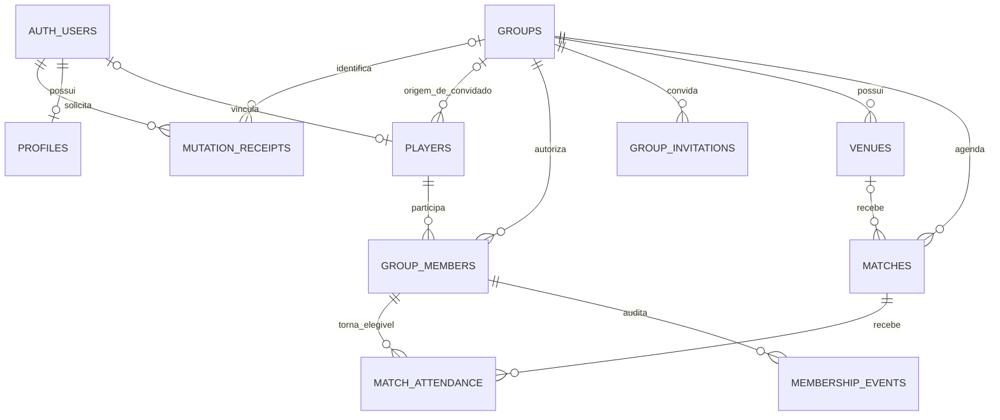

# Banco de dados — Etapa 002

## Estado e diferenças da proposta inicial

**As cinco migrations foram aplicadas ao desenvolvimento em 20/10/2026.** A sexta migration da Etapa 002.3 corrigiu as chamadas ao helper Auth por private.auth_user_id(), sem conceder USAGE em auth ao executor. Smoke SQL remoto passou, sem equivaler a testes HTTP/JWT. Ver DEPLOYMENT.md e VERIFICATION.md. Não há dados reais ou seed de produto. `supabase/config.toml` expõe somente `public`, não `private`, e desabilita seed.

A especificação do Prompt 002 substitui propostas ainda não aprovadas da Etapa 001:

| Etapa 001 (proposta)                    | Etapa 002 (implementação solicitada)                                                |
| --------------------------------------- | ----------------------------------------------------------------------------------- |
| profiles.id independente + auth_user_id | profiles.id = auth.users.id                                                         |
| players por grupo + member_id opcional  | players global por conta, user_id opcional; convidado protegido por origin_group_id |
| group_members por profile_id            | group_members por player_id                                                         |
| owner/admin/member                      | owner/admin/player/guest                                                            |
| active/suspended/left                   | active/invited/suspended/left                                                       |
| convite por e-mail e uso único          | hash de convite com max_uses/uses_count; sem aceite público                         |
| attendance pending/confirmed/declined   | confirmed/waitlisted/declined/cancelled                                             |
| time_zone e avatar_path                 | timezone, avatar_url e logo_url                                                     |

Mantidos: UUIDs, instantes timestamptz, identidade esportiva separada de acesso, múltiplos grupos por conta, isolamento por vínculo ativo, integridade composta, histórico, ausência de user_metadata na autorização e frontend sem credenciais privilegiadas.

## Relações

Uma conta tem no máximo um profile e um player global vinculado. Um player pode ter um vínculo em cada grupo e papéis diferentes entre eles. Um convidado sem conta pertence ao grupo de origem e só pode ter papel guest. `group_members` é a fonte de autorização; um player não concede acesso por si só.

## Convenções

Todas as entidades têm PK UUID. profiles.id vem de auth.uid(); os demais IDs usam gen_random_uuid(). created_at/updated_at são timestamptz com default now(); trigger define updated_at usando clock_timestamp() em cada UPDATE. IDs, identidade, tenant, autores e created_at não podem ser reatribuídos por clientes. Slug e dados estruturais de convites são imutáveis nesta versão.

Os campos abaixo são NOT NULL, salvo `?`. Nomes exigem conteúdo após trim e comprimento limitado. URLs opcionais são referências HTTPS de até 2048 caracteres; o app ainda não renderiza uploads de domínio. Não são autorização de Storage nem garantia de integridade de conteúdo externo. Objetos privados e URLs assinadas persistidas exigirão revisão específica.

Datas representam instantes, não texto local. `groups.timezone` guarda o nome do fuso (padrão America/Sao_Paulo), validado contra pg_timezone_names em trigger. Converter entrada local + fuso para timestamptz no futuro, tratando DST. O banco não infere fuso pelo navegador.

## Tabelas e constraints

### profiles — dados privados da conta

- `id uuid PK DEFAULT auth.uid() REFERENCES auth.users(id) ON DELETE CASCADE`.
- `display_name text` (1–100 após trim), `avatar_url? text`, created_at e updated_at.
- PK garante no máximo um perfil por conta. Leitura/escrita só do próprio usuário; nenhum membro pode ler profile de terceiro por compartilhar grupo.
- Cliente só insere/edita display_name/avatar_url; id é preenchido pelo Auth. Não há trigger de cadastro usando metadados de usuário. O fluxo de criação de perfil ainda precisa ser integrado à aplicação.

### players — identidade esportiva

- `id uuid PK`, `user_id? uuid UNIQUE REFERENCES auth.users(id) ON DELETE RESTRICT`, default auth.uid().
- `origin_group_id? uuid REFERENCES groups(id) ON DELETE RESTRICT`.
- `name text` (1–100), `nickname? text` (até 60), `preferred_position? text` (goalkeeper/defender/midfielder/forward), `avatar_url? text`.
- `created_by uuid REFERENCES auth.users(id) ON DELETE RESTRICT`, created_at, updated_at, `deleted_at? timestamptz`.
- CHECK: player vinculado tem user_id e nenhuma origem; convidado tem user_id NULL e origem obrigatória. UNIQUE user_id limita a uma identidade global por conta, incluindo arquivadas.
- Cliente cria somente identidade própria; campos user_id/origin_group_id nunca têm grants de UPDATE. Trigger impede alteração mesmo por outro caminho SQL. Admin pode editar atributos de convidados do próprio grupo, mas não o nome global de outra conta.

**Vinculação futura de convidados:** deliberadamente não existe RPC de claim. Não usar nome, nickname, e-mail digitado ou user_metadata como prova. A futura operação exigirá sessão da conta de destino, consentimento explícito e autorização do grupo de origem, prova de uso único com expiração, lock do player/vínculos e resolução de conflito com player já existente. A migração desse fluxo deverá substituir conscientemente a restrição de identidade imutável; não liberar UPDATE user_id para realizá-lo. Assim, não há apropriação unilateral nesta etapa.

**Privacidade global:** nome/apelido/posição do player vinculado são compartilhados entre os grupos dos quais ele participa; somente o próprio usuário os edita. Nome esportivo diferente por grupo exigirá atributos locais no vínculo em uma decisão futura. Convidados sem conta não podem ser anexados a outro tenant. Não há catálogo público de jogadores.

### groups — tenant

- id UUID; `name` 1–100; `slug text UNIQUE` global, 3–64, minúsculas/números/hífens sem hífen inicial/final/duplicado.
- `description?` até 1000; `logo_url?`; `timezone text DEFAULT 'America/Sao_Paulo'` validado.
- `created_by uuid REFERENCES auth.users(id) ON DELETE RESTRICT`; created_at, updated_at, deleted_at?.
- Slug não é reutilizado por exclusão lógica. created_by é auditoria, não autorização.
- Existe exatamente um owner ativo por grupo nesta versão. Índice único parcial limita o máximo; constraint triggers diferidas verificam o mínimo e a elegibilidade do proprietário no final da transação. Não basta um índice para garantir existência.

### group_members — autorização e reingresso

- id UUID; group_id FK groups; player_id FK players, ambas ON DELETE RESTRICT.
- role CHECK owner/admin/player/guest; status CHECK active/invited/suspended/left.
- joined_at, created_at e updated_at timestamptz.
- UNIQUE `(group_id,player_id)` vale para todos os status, mais forte que unicidade apenas ativa. Reingresso atualiza o mesmo vínculo para active, preserva joined_at e registra evento; não cria uma segunda identidade/vínculo.
- Owner sempre precisa de conta vinculada, player não arquivado e status active. Convidado sem conta só pode ser guest no grupo de origem. Somente active autoriza acesso ao grupo; invited não concede acesso privado.
- Sem INSERT/UPDATE/DELETE direto por authenticated, nem mesmo owner. Alterações usam operações estreitas. O próprio usuário não pode alterar seu papel/status pelas RPCs genéricas. Não há saída autônoma implementada.

### group_invitations — segredos protegidos

- id UUID; group_id FK groups; `token_hash text UNIQUE` (64 dígitos hex minúsculos, SHA-256 esperado de token aleatório forte).
- role CHECK admin/player/guest, nunca owner; expires_at > created_at; max_uses > 0; 0 <= uses_count <= max_uses.
- created_by FK auth.users RESTRICT; created_at, updated_at, revoked_at? >= created_at.
- Não há SELECT/INSERT/UPDATE/DELETE de tabela para clientes; RLS habilitado sem policies permissivas. `list_invitations` retorna somente metadados autorizados, sem hash. Não há token em texto puro ou aceite público.
- A rotina futura de aceite bloqueará o convite, verificará token/expiração/revogação/limite e incrementará uses_count junto com criação/reativação de vínculo na mesma transação. Isso não está implementado. Criar uma linha não significa enviar ou aceitar um convite.

### venues — locais privados por grupo

- id UUID; group_id FK groups RESTRICT; name 1–120; address? até 500; created_at, updated_at, deleted_at?.
- UNIQUE `(group_id,id)` suporta a FK composta de matches.
- Índice UNIQUE parcial `(group_id,lower(btrim(name)))` para locais não arquivados. Essa regra inicial não permite dois locais ativos de mesmo nome no grupo; endereços distintos não eliminam a colisão.

### matches — agenda mínima

- id UUID; group_id FK groups RESTRICT; venue_id? com FK `(group_id,venue_id)` → venues(group_id,id) RESTRICT.
- title 1–120; starts_at, ends_at timestamptz com ends_at > starts_at; capacity integer > 0.
- status CHECK scheduled/cancelled/completed; created_by FK auth.users RESTRICT; created_at, updated_at, deleted_at?.
- UNIQUE `(group_id,id)` para referência de presença. Trigger recusa local de outro grupo ou arquivado e capacidade abaixo do total já confirmado.
- Nenhuma unicidade de horário foi imposta: partidas simultâneas no grupo ficam possíveis até decisão de produto. Não há competição, placar ou finanças implementados.

### match_attendance — presença e elegibilidade

- id UUID; group_id FK groups; match_id, player_id e status CHECK confirmed/waitlisted/declined/cancelled; created_at e updated_at.
- `group_id` adicional permite FKs compostas: `(group_id,match_id)` → matches e `(group_id,player_id)` → group_members; todas RESTRICT.
- UNIQUE `(match_id,player_id)` em qualquer status. Alterar uma resposta usa o mesmo registro, sem duplicar inscrição.
- Trigger exige vínculo active e player não arquivado na nova associação, inclusive quando um admin registra o convidado. Nova confirmação/entrada em espera também revalida elegibilidade. Cancelar/recusar uma inscrição histórica já existente não exige reativar o jogador, mas exige que o autor ainda seja membro autorizado. Partida deve estar scheduled e não arquivada.
- Histórico não é apagado quando o vínculo muda para left/suspended. O status antigo da inscrição não concede acesso ao grupo.

### private.membership_events — auditoria interna

Tabela técnica, não um módulo adicional exposto. id UUID, member_id FK RESTRICT, actor_user_id? FK Auth RESTRICT, old_values/new_values JSONB e occurred_at. Trigger registra criação e mudanças de role/status, incluindo transferência e reingresso. Sem grants de tabela ou RPC de leitura a clientes; RLS habilitado. Eventos participam da mesma transação: rollback administrativo também reverte auditoria. Retenção/análise administrativa dessa trilha ainda requer política de privacidade.

## Índices

PKs/UNIQUEs já têm índices. Adicionais:

| Tabela            | Índices                                                                                                      |
| ----------------- | ------------------------------------------------------------------------------------------------------------ |
| players           | origin_group_id parcial não nulo, created_by; user_id já único                                               |
| groups            | created_by; slug já único                                                                                    |
| group_members     | `(player_id,group_id) INCLUDE(status,role)`; owner ativo único parcial; `(group_id,player_id)` único         |
| group_invitations | `(group_id,expires_at)`, created_by; hash único                                                              |
| venues            | `(group_id,id)` único e nome ativo único                                                                     |
| matches           | `(group_id,starts_at DESC)` parcial não arquivados; `(group_id,venue_id)`; created_by; `(group_id,id)` único |
| match_attendance  | `(group_id,match_id,status)`; `(group_id,player_id)`; `(match_id,player_id)` único                           |
| membership_events | `(member_id,occurred_at)`, actor_user_id parcial não nulo                                                    |

Cada FK tem índice de prefixo apropriado sem repetir índices já cobertos. Medir EXPLAIN e volume real antes de acrescentar índices especulativos.

## RLS e privilégios

A identidade vem de auth.uid(), nunca de user_metadata. Helpers privados procuram o player vinculado e o vínculo active no grupo não arquivado. Papéis não ficam em claims de JWT: mudanças são verificadas no banco. Tokens assinados são validados pelo gateway Supabase; conexão SQL direta autenticada não é distribuída a clientes.

| Tabela            | SELECT                                                                 | Escrita de cliente                                                                           |
| ----------------- | ---------------------------------------------------------------------- | -------------------------------------------------------------------------------------------- |
| profiles          | Próprio usuário                                                        | INSERT/UPDATE apenas display_name/avatar_url com id=auth.uid()                               |
| players           | Próprio player ou jogador do elenco de um grupo autorizado             | Criar próprio player; editar próprio ou convidado da origem gerenciada, só campos esportivos |
| groups            | Membro active                                                          | UPDATE de nome/descrição/logo/timezone por owner/admin; criação somente RPC                  |
| group_members     | Elenco do grupo autorizado ou próprio vínculo, inclusive suspenso/left | Somente RPCs verificadas                                                                     |
| group_invitations | Nenhum SELECT de tabela                                                | RPCs de criação/listagem sanitizada/revogação                                                |
| venues            | Membro active, local não arquivado                                     | INSERT/UPDATE de campos permitidos por owner/admin                                           |
| matches           | Membro active, partida não arquivada                                   | INSERT/UPDATE de campos permitidos por owner/admin                                           |
| match_attendance  | Membro active                                                          | Registrar/alterar próprio player; owner/admin registram membros elegíveis/convidados         |

UPDATE tem USING e WITH CHECK e SELECT correspondente. Grants de coluna e triggers impedem troca de id, group_id, player_id, user_id, creator e papéis; pertencer a A **e** B não permite mover dados entre eles. Nenhum cliente recebe DELETE físico. `anon` não tem acesso às tabelas nem RPCs administrativas. Convites e auditoria são deny-by-default.

Helpers RLS consultam as tabelas como dono técnico para evitar ciclos de policies. `app_executor` é NOLOGIN, NOINHERIT, NOSUPERUSER e NOBYPASSRLS; possui somente as tabelas de aplicação e funções privadas, sem SELECT de auth.users. Bypass se limita à propriedade dessas tabelas. Não conceder esse papel a authenticated/anon/authenticator ou permitir login. Não usar FORCE RLS nessas tabelas sem redesenhar os helpers, pois causaria recursão.

Todas as funções SECURITY DEFINER ficam em private, com search_path vazio, nomes qualificados e EXECUTE revogado de PUBLIC/anon/authenticated por padrão. Somente helpers de leitura e implementações administrativas especificamente autorizadas têm EXECUTE para authenticated. As implementações de RPC verificam auth.uid()/papel; triggers de invariantes não são invocáveis pelo cliente. Wrappers em public são SECURITY INVOKER. private tem USAGE para avaliação das policies, mas não é schema exposto pela API. Não adicionar private à configuração de schemas expostos.

## Operações transacionais

| RPC pública        | Comportamento                                                                                                                 |
| ------------------ | ----------------------------------------------------------------------------------------------------------------------------- |
| create_group       | Exige profile próprio; cria/reutiliza player próprio, grupo e primeiro owner na mesma transação                               |
| add_guest          | Owner/admin cria player sem conta e vínculo guest no próprio grupo atomicamente                                               |
| set_member_role    | Owner pode atribuir admin/player/guest a terceiros; admin apenas player/guest de nível inferior; nunca owner ou próprio papel |
| set_member_status  | Owner/admin altera terceiros elegíveis, nunca owner, próprio status ou admin de mesmo nível                                   |
| transfer_ownership | Somente owner atual; destino active com conta; antigo owner vira admin e destino vira owner atomicamente                      |
| create_invitation  | Owner convida admin/player/guest; admin apenas player/guest; recebe hash, nunca token original                                |
| list_invitations   | Owner/admin; retorna metadados sem hash                                                                                       |
| revoke_invitation  | Owner/admin, mas admin não revoga convite para admin                                                                          |

Operações de vínculo/propriedade bloqueiam a linha do grupo **antes de autorizar**. Transferências concorrentes são serializadas e o papel é revalidado; a antiga conta não pode recuperar propriedade por uma requisição que ficou esperando. Erros em qualquer parte revertem todas as escritas, inclusive player novo e auditoria. Índice parcial mais constraints diferidas garantem exatamente um owner ativo elegível ao final, mesmo contra DML privilegiado fora das RPCs.

Presença bloqueia primeiro a partida e depois o grupo; UPDATE de partida segue a mesma ordem. A contagem serializada já impede ultrapassar capacity. O cliente deve escolher waitlisted quando não houver vaga; não existe algoritmo de promoção automática, FIFO, ordenação estável ou cancelamento em cascata de inscrições. A próxima etapa deverá encapsular confirmação/cancelamento/promoção numa operação idempotente, com chave de ordem persistida e locks iguais. Não tratar um SELECT de vagas no frontend seguido de INSERT como reserva atômica.

## Histórico e exclusão

Vínculos são únicos ao longo do tempo e usam status + eventos. Presenças são únicas e usam status. Exclusão lógica está preparada em players/groups/venues/matches, mas o cliente não recebe grants para arquivamento e não há RPC de arquivo genérico nesta etapa. A futura implementação de arquivamento precisará resolver owner e históricos. O trigger já recusa arquivar o único owner.

FKs históricas usam RESTRICT: conta Auth que possui player/autoria/auditoria não pode simplesmente ser apagada. profiles usa CASCADE, mas outras referências bloqueiam a remoção até existir um processo explícito de anonimização/retenção e transferência de propriedade. Essa escolha evita grupos órfãos e perda silenciosa; o fluxo de eliminação de PII é uma pendência obrigatória antes de produção. Revogação de sessões e expiração de JWT também devem ser consideradas; remover conta não invalida automaticamente todo token emitido.

## Validação local e limites

`npm run db:test` cria um container PostgreSQL 17.6 fixado por digest, sem rede e sem portas, aplica as cinco migrations e executa testes com session_user/current_user authenticated/anon. A preparação de fixtures é privilegiada; os testes de acesso não são. Checagens de defesa contra DML de dono são separadas e explicitadas. Todos os dados são sintéticos e o container é removido ao final.

O bootstrap de testes reproduz apenas auth.users(id), auth.uid() e os papéis necessários: não é o serviço Auth nem PostgREST/Storage completos. Antes da implantação será necessário validar também em Supabase local com suas extensões, default privileges e versão de PostgreSQL, rodar db lint/advisors, gerar tipos e fazer testes HTTP com JWTs reais de desenvolvimento. Nenhum teste usa service role para demonstrar RLS.

Referências consultadas: [RLS](https://supabase.com/docs/guides/database/postgres/row-level-security), [segurança da API](https://supabase.com/docs/guides/api/securing-your-api), [changelog](https://supabase.com/changelog), [constraints PostgreSQL](https://www.postgresql.org/docs/current/ddl-constraints.html).

## Ponte de identidade aplicada — Etapa 002.3

Exceção mínima ao proprietário app_executor: somente private.auth_user_id() pertence a postgres, retorna auth.uid() sem argumentos ou SELECT de tabelas e tem SECURITY DEFINER STABLE/search_path vazio. Sua ACL permite EXECUTE apenas ao proprietário e a app_executor. As sete funções dependentes preservam owner/ACL e regras; chamadas indiretas retornam a identidade da sessão, sem permitir escolher outro usuário. app_executor permanece sem USAGE em auth e sem SELECT em auth.users. Smoke SQL remoto passou; não equivale a teste HTTP/JWT real. Definição completa em supabase/migrations/20261020160133_auth_schema_bridge.sql.

## Etapa 003 — sétima migration

20261020161609_stage003_identity_workflows.sql, aplicada como MCP 20261020162554. private.mutation_receipts: PK composta (actor_user_id FK auth.users RESTRICT, request_id UUID); operation CHECK create_group/add_guest; input_hash bytea SHA-256; group_id FK groups RESTRICT e result_id UUID; created_at timestamptz. Índice adicional apenas group_id, pois o PK já cobre busca por ator/requisição e FK do ator. RLS sem policies e zero grants a clientes. Não exposta pela Data API. Guarda hash dos campos, sem payload, senha ou token. Retenção e anonimização pendentes antes de produção; recibo não concede acesso.

APIs novas: ensure_my_identity(text), save_my_identity(text,text,text,text), create_group_once(uuid,text,text,text,text), add_guest_once(uuid,uuid,text,text,text). Não recebem IDs de perfil/conta para edição. As duas primeiras restringem a auth_user_id(); convidados revalidam require_manager; grupo continua usando create_group_impl para owner atômico. Recibos são bloqueados e comparados por operação/payload; retries recuperam o resultado e erros revertem todas as escritas. add_guest_once grava posição junto ao player/vínculo existente; não edita identidade global alheia.

As quatro novas entradas são SECURITY DEFINER com owner técnico app_executor, search_path vazio, checagem de identidade explícita e EXECUTE apenas authenticated. Novas implementações privadas têm EXECUTE revogado para clientes; não houve grants de schema Auth, leitura de auth.users ou CREATE público persistente. Os wrappers anteriores continuam invoker. Detalhes da revisão de risco e avisos esperados em STAGE003.md. Essa é uma fronteira de autorização explícita, não RLS genérico permissivo.

## Etapa 004.2 — agendas e configurações financeiras (somente local)

Oitava migration preparada, sem aplicação remota: `20261027143201_stage0042_group_configuration.sql`. Acrescenta group_schedules (recorrência local no fuso do grupo), group_pricing_policies (preços explícitos em centavos, somente owner) e member_billing_terms (classificação por vínculo, owner/admin). FKs compostas impedem associações entre grupos; exclusões GiST btree_gist protegem intervalos financeiros `[início,fim)`. Sem seed, cobrança ou geração de encontros. RLS, grants de coluna, locks e guards privados preservam tenant, histórico e papéis. Um trigger adicional em group_members impede tornar guest quem ainda tem classificação monthly atual/futura; nenhuma policy existente é alterada. Detalhes, matriz de leitura/escrita, compatibilidade, testes e aplicação futura em [STAGE0042.md](STAGE0042.md). Sete migrations remotas anteriores permanecem no manifesto; não reaplicar.
