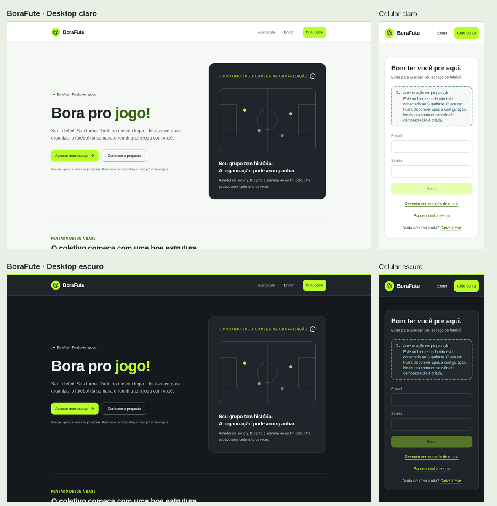

# Etapa 004.2-V — identidade visual BoraFute

Implementação na develop, base d449d52acfb0e77d2dd011066e7c0539be398c9f, em 27/10/2026. Design System em [DESIGN_SYSTEM.md](DESIGN_SYSTEM.md). Mantidos os layouts, rotas, formulários, guardas e regras existentes.

## Escopo entregue

Identidade oficial BoraFute, slogan e frase institucional; tokens de cores, tipografia, superfícies, sombras, bordas, foco/erro/sucesso e movimento reduzido; temas claro/escuro por sistema. Atualizados componentes compartilhados, home, layout público/privado, apresentação das mensagens, metadata, manifesto e ícones PWA. Login, cadastro, recuperação, dashboard, grupos e perfil recebem o sistema sem reescrever consultas/ações. A marca de nenhum tenant foi incorporada ao produto.

Arquivos: src/app/globals.css e src/lib/brand.ts; componentes ui/layout/forms; home/layouts/metadata/manifest; mensagens em dashboard/grupo/login/recuperação/redefinição, AuthForm e ActionForm; títulos de confirmação/recuperação; campos nativos; public/icons; tests/design-system.test.ts e documentação. Não houve alteração de migrations, clients/configuração Supabase, funções de autenticação, RLS, dependências de aplicação ou dados.

## Verificações e evidências

| Verificação                                      | Resultado                                                                                   |
| ------------------------------------------------ | ------------------------------------------------------------------------------------------- |
| Lint                                             | PASS                                                                                        |
| Typecheck                                        | PASS                                                                                        |
| Vitest                                           | 177 testes PASS em 16 arquivos; 51 verificações novas de contraste/manifesto                |
| Build de produção local                          | PASS, sem publicação                                                                        |
| Executor público/preparação existente            | 45 PASS, zero FAIL, 40 visitas em quatro combinações                                        |
| Capturas complementares home/login/recuperação   | 12/12 verificações PASS: HTTP 200, nome oficial e ausência de overflow                      |
| Formatação dos arquivos alterados / diff --check | PASS                                                                                        |
| Formatação global                                | FAIL preexistente apenas em docs/STAGE0032.md e docs/STAGE0032-UI-CHECKLIST.md; preservados |
| Páginas privadas com sessão real                 | PENDENTE                                                                                    |

Contraste: 50 pares e consistência de manifesto, todos aprovados. Não confundir contraste de tokens com auditoria WCAG completa. Revisão React: fronteiras server/client, hooks, props, labels, roles de mensagens e submissões existentes preservados; não houve nova busca de dados, efeito, armazenamento de sessão ou lógica de autorização.

| Combinação                | Público / preparação local | Dashboard, grupo e perfil autenticados |
| ------------------------- | -------------------------- | -------------------------------------- |
| Desktop 1440 × 900 claro  | PASS                       | PENDENTE                               |
| Desktop 1440 × 900 escuro | PASS                       | PENDENTE                               |
| Celular 390 × 844 claro   | PASS                       | PENDENTE                               |
| Celular 390 × 844 escuro  | PASS                       | PENDENTE                               |

Origem testada: http://127.0.0.1:3312; a porta 3300 estava ocupada e seu processo foi preservado. Runner: scripts/test-stage0032-ui.mjs --local-public; relatório work/stage0032-ui-d36be548-ffb8-4935-9ce7-d08d58a33d1c/report.json. Rotas: home, login, cadastro, recuperação/contexto, confirmação, redefinição, dashboard/grupo novo/perfil em preparação e página inexistente. Sem overflow, erros JavaScript/HTTP/rede inesperados ou inputs visíveis sem labels, conforme checks do runner; foco básico via Tab, não jornada completa de teclado.

Capturas adicionais: work/stage0042v-visual/report.json e doze PNGs sem dados de usuários, home/login/recuperação nos quatro contextos. Inspecionados a home desktop clara e login móvel escuro, além da composição com home desktop claro/escuro e login móvel claro/escuro. Aparência legível e sem cortes nas amostras; não atribuir inspeção humana individual às demais capturas. Fundos calculados #F6F8F5 e #15191D, conforme tema. Logs locais em work/stage0042v-{lint,typecheck,unit,build,ui,captures,format-check}.log.

Amostras públicas locais sem Supabase configurado: campos de login desabilitados por segurança. O resumo não representa autenticação ou homologação de conteúdo privado. Texto das legendas foi acrescentado apenas ao painel de evidências, não ao produto.

A conferência local utiliza build de produção em loopback sem configuração Supabase: páginas públicas e estados de preparação, sem autenticação fictícia. Chromium 154.0.8037.57 já disponível; Playwright 1.62.1 instalado apenas em work/ui-tools ignorado, pois o pacote não estava disponível no checkout. Nenhum pacote foi acrescentado a package.json/package-lock e nenhuma instalação de navegador foi necessária.

**Limite independente:** sem contas/secrets locais e com a homologação Supabase bloqueada pelo registry, não foi possível navegar em dashboard/grupos/perfil com sessão real. Não usar dados/credenciais do ambiente hospedado para substituir essa conferência. A aplicação da identidade às telas privadas ocorre pelos componentes/tokens e alterações de apresentação verificadas no código; homologação visual autenticada permanece PENDENTE.

## Pendências e preservação

- Conferir as páginas privadas com contas sintéticas em ambiente local apropriado, nos dois dispositivos/temas, incluindo mensagens e estados de submissão reais.
- Complementar teclado/leitor de tela, zoom, touch e Safari/iOS reais, além dos pares de contraste e navegação básica automatizados.
- Conferir atualização dos ícones em instalação PWA futura; caches do navegador podem manter a identidade anterior. Não foi criado service worker ou cache offline.
- **Etapa 004.2-H continua BLOQUEADA/PENDENTE**, sem aplicação remota, tipos locais completos ou testes JWT/Data API novos. A identidade visual não resolve nem altera aquele status.
- Nenhuma modificação de main, produção, domínio/DNS, Resend, Auth/RLS, configurações administrativas ou dados reais; sem merge ou deploy.
