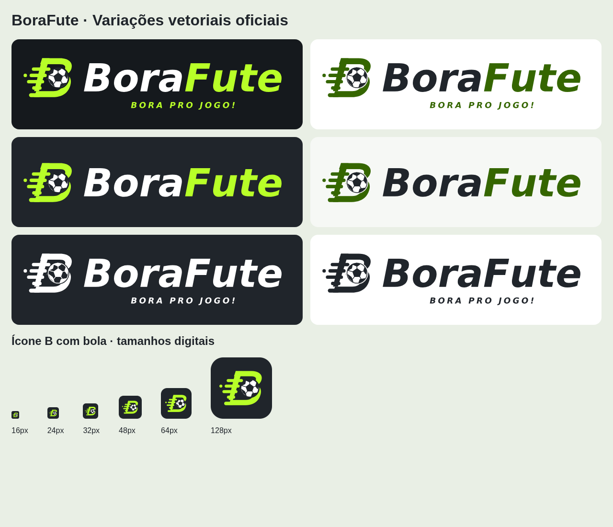

# Etapa 004.2-V.1 — consolidação da marca

Trabalho na develop, sobre 412f7cea16507e9d7ede6c78801ed9c7a4f45e15. Referência conceitual recebida e inspecionada em 27/10/2026 antes de desenhar os vetores. Uso de B estilizado, futebol integrado e velocidade conforme conceito; sem reutilização da captura como logotipo rasterizado. Guia e arquivos em [BRAND.md](BRAND.md).

## Implementação

Nove SVGs oficiais para principal/horizontal/símbolo e variações de cor/monocromáticas, SVG de favicon e quatro PNGs derivados. Geradores únicos, licença da base tipográfica, dados institucionais centralizados e componente Brand compartilhado. Cabeçalho público, lateral, home, login/cadastro integrados. Área de marca grafite nos dois temas; formulários/cartões continuam distinguíveis e respeitam a preferência do sistema. Sem bibliotecas novas de aplicação, mudanças de rotas, ações ou permissões.

## Validação

| Verificação                                                                   | Resultado                                                                  |
| ----------------------------------------------------------------------------- | -------------------------------------------------------------------------- |
| Lint                                                                          | PASS                                                                       |
| Typecheck                                                                     | PASS                                                                       |
| Vitest                                                                        | 229 testes PASS em 18 arquivos                                             |
| Build de produção local                                                       | PASS, sem publicação                                                       |
| Vetores autocontidos, variantes, alternativas acessíveis                      | PASS, sem raster/fonte/script externo nos SVGs                             |
| PNGs 192/512/180 e redução digital                                            | PASS                                                                       |
| Maskable: opacidade e símbolo na área segura central (raio 40% da largura)    | PASS                                                                       |
| Contraste do Design System e áreas grafite em página clara                    | PASS, sete verificações novas de pares de texto/controles da área de marca |
| Navegação pública/preparação: quatro combinações                              | 45 PASS, zero FAIL na passagem final                                       |
| Conferência complementar home/login/cadastro/recuperação/perfil em preparação | 20 PASS: HTTP 200, imagens carregadas e sem overflow                       |
| Galeria de versões e ícones em 16/24/32/48/64/128 px                          | 12 imagens carregadas; inspeção de reprodução digital                      |
| Formatação alterados / diff --check                                           | PASS                                                                       |
| Formatação global                                                             | FAIL preexistente nos dois documentos da Etapa 003.2, preservados          |
| Conteúdo privado autenticado, Safari/iOS/touch, instalação PWA real           | PENDENTE                                                                   |

Testes automatizados conferem que os SVGs são vetores autocontidos, alternativas acessíveis, seleção de variantes, PNGs nas dimensões PWA e renderização reduzida sem imagem vazia. O teste de maskable verifica pixels de tinta dentro do círculo seguro e opacidade total. Detalhes da bola diminuem naturalmente em 16 px; ícones pequenos não carregam nome/slogan. A validação visual não constitui teste de login ou banco.

Ambiente: Next.js 16.4.2, Node 24.19.0, Chromium 154.0.8037.57 com Playwright 1.62.1 já instalado em work ignorado. Origem http://127.0.0.1:3316, build sem Supabase configurado, sem cadastro/login/submissão. Viewports 1440×900 e 390×844, claro/escuro. Capturas inspecionadas: galeria de versões/ícones, login móvel claro e home desktop escura. As demais visitas têm verificações automatizadas, não alegação de inspeção humana individual.

Evidências ignoradas: work/brand-v1-visual/report.json, vinte capturas por rota/contexto, work/brand-v1-gallery.png e logs work/brand-v1-*.log. Passagem final do executor: work/stage0032-ui-0bdf4a7c-f8e9-44c7-85dd-9963c233f847/report.json. A primeira passagem foi interrompida em mobile_dark_/profile após 43 checks aprovados, sem asserção registrada como reprovada, run 2111183c-6fbf-4745-8a2c-83b7f587c051. Uma captura complementar concorrente também foi interrompida; causa histórica não identificada. A leitura direta de /profile respondeu 200, a passagem complementar sequencial passou 20/20 e a repetição do executor passou 45/45. Não atribuir retrospectivamente a interrupção a defeito de produto ou a causa de infraestrutura não demonstrada. Nenhuma regra de aprovação foi afrouxada; os executores permanentes anteriores não foram alterados.

O painel usa os SVGs/PNGs reais sobre fundos de prova; não incorpora a imagem conceitual no produto.

A verificação usa build local sem configuração Supabase. Dashboard/grupos/perfil autenticados não são homologados por essa execução; apenas a integração do componente lateral no código foi revisada. Não foram usadas contas, dados ou tokens reais.

## Preservação

004.2-H continua BLOQUEADA/PENDENTE conforme registro anterior, sem mudança de status. Migrations, Supabase Auth/RLS, dados reais, main, DNS, domínio, configurações administrativas e dependências de aplicação preservados. Nenhum merge ou deploy; somente commit/push de código/assets/documentação na develop.
